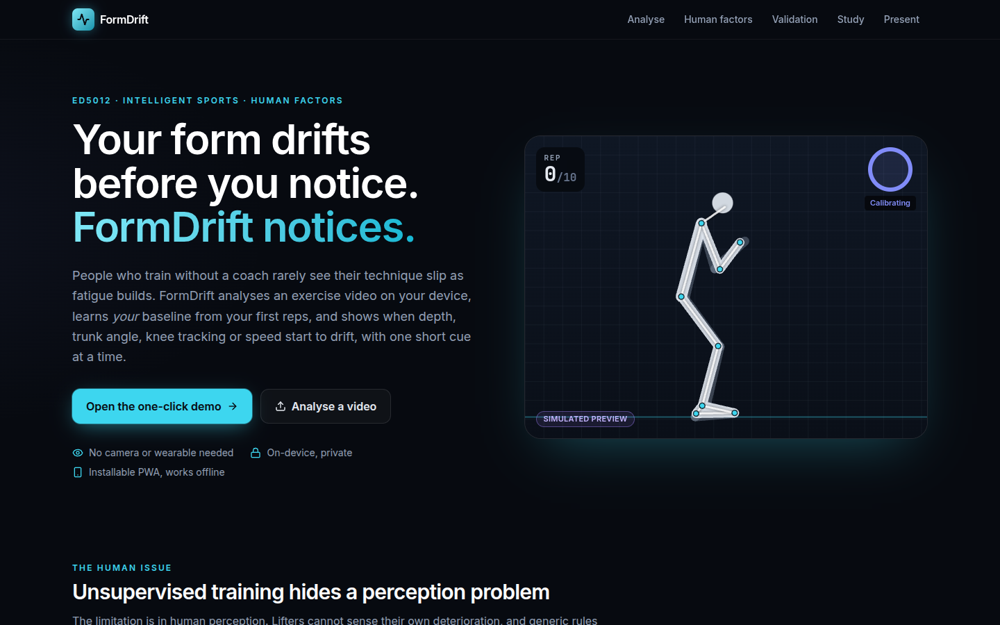

# FormDrift: Exercise Technique Drift Analyser

**ED5012 Advanced Applications of Human Factors in Design · IIT Madras · Domain: Intelligent Sports**

FormDrift is a Progressive Web App that analyses a video of a squat set **on the user's own device** and shows **when and how technique starts to drift** as fatigue builds. Each rep is compared with the lifter's own first reps (a personal baseline), not with a textbook ideal. The app gives one short, low-workload cue per rep and ends with an evidence-based summary.



> **The human issue:** people training without a coach cannot see their own form, and joint-position sense worsens with fatigue, so gradual deterioration across a set goes unnoticed.

| | |
|---|---|
| Live app | **https://formdrift.apps.grok.bot** |
| Project report (20 pages) | [PDF](docs/report/FormDrift_Report.pdf) · [LaTeX source](docs/report/FormDrift_Report.tex) |
| Presenter's guide (talk, demo steps, Q&A) | [PDF](docs/report/FormDrift_Presenter_Guide.pdf) · [LaTeX source](docs/report/FormDrift_Presenter_Guide.tex) |
| Slide deck | In the app at `#/present` (arrow keys; **F** for fullscreen) · [PDF backup](docs/FormDrift_Slides.pdf) |
| Backup demo video (silent, 94 s) | [`docs/media/FormDrift_demo_backup.mp4`](docs/media/FormDrift_demo_backup.mp4) |

## What it does

- **One-click demo mode.** Four preloaded sets: two simulated fatigue sets with known ground truth (side and front camera) and two real, Creative Commons licensed videos. No camera, wearable or hardware is needed.
- **Analyse your own video.** Drop an MP4/WebM/MOV file. MediaPipe Pose Landmarker runs in the browser (WebAssembly + WebGL) and nothing is uploaded.
- **Per-rep analysis.** Automatic camera-view detection (side / front / oblique), rep segmentation, depth, trunk lean, knee tracking (valgus), lateral hip shift, concentric velocity, movement consistency (DTW), tempo, a 100-point rep score, drift onset and a trend line.
- **Clear labelling.** Every result is labelled *real video · measured*, *simulated data* or *your video · measured*. Metrics that the camera angle cannot support are shown as "not measurable". Low-confidence reps are flagged.
- **Human-factors feedback.** A cue engine with priority, cooldown, repeat limits and escalation. Feedback modes are combined, visual, audio (Web Speech), haptic (Vibration API) and silent.
- **Biomechanics and anthropometry.** A static L5/S1 compression estimate per rep (compared with the NIOSH action limit) and measured segment ratios against Drillis & Contini norms.
- **Evaluation built in.** A ground-truth comparison for the simulated sets, real-clip rep counts, a noise-robustness sweep, and a SUS + NASA-TLX study toolkit with CSV export.
- **PWA.** Installable and works offline after the first visit: the service worker caches the app shell, demo videos and cached landmarks. The MediaPipe model and WASM are cached the first time a live analysis runs.

## Quick start

Requires Node.js 20 or newer (tested with 22).

```bash
npm install
npm run dev        # http://localhost:5173
```

Production build and local preview (this also exercises the service worker):

```bash
npm run build
npm run preview    # http://localhost:4173
```

Checks:

```bash
npm run lint       # oxlint
npm run verify     # analysis regression checks (rep counts, F1, false alarms)
npm run smoke      # headless browser walk-through of every page; needs `npm run dev` running and Google Chrome
node scripts/offline-test.mjs   # offline PWA check; needs `npm run preview` running
```

## Using it

1. Open the app and click **Open the one-click demo**, or go to **Analyse** and pick a set.
2. Click **Analyse this set**. Answer the self-perception question ("when did your form slip?"); this reveals the awareness gap.
3. Press **Play** to watch the skeleton overlay, live rep counter, status ring and cues. Turn on **Analyst** for numbers.
4. Explore the tabs: Overview, Rep by rep, Biomechanics, Body proportions, Feedback log, Ground truth (simulated sets only), Data & export.
5. **Human factors** explains the 4W1H and HF rationale; **Validation** shows the live accuracy figures; **Present** is the slide deck.

Filming tips for your own video: side view for depth and trunk lean, front view for knees and hips; whole body in frame with the camera at hip height about 3 m away; even lighting with nothing bright behind you.

## Architecture

```
Video (upload or demo) ──► Pose extraction ──► Signal processing ──► Rep segmentation ──► Baseline + drift ──► Cues + UI
                           MediaPipe Tasks      gap fill, zero-phase   hysteresis on hip     median of first N    priority, cooldown,
                           Vision (WASM/GPU)    Gaussian smoothing     depth, sub-frame      reps; % or absolute  repeat limit,
                           15 fps, seek-based                          tempo crossings       deviation; DTW       escalation
```

| Path | Responsibility |
|---|---|
| `src/lib/pose/landmarker.ts` | Loads MediaPipe Pose Landmarker (full model, GPU with CPU fallback); deterministic frame-by-frame extraction by seeking |
| `src/lib/analysis/analyze.ts` | The analysis pipeline: view classification, smoothing, rep segmentation, per-rep metrics, baseline, deviations, scores, trend, drift onset, issues |
| `src/lib/analysis/metrics.ts` | Metric definitions: units, thresholds, weights, cues, valid views, explanations and drills |
| `src/lib/analysis/feedback.ts` | Cue engine (information-handling rules) and feedback modes |
| `src/lib/analysis/biomech.ts` | Static sagittal L5/S1 moment and compression model |
| `src/lib/analysis/anthropometry.ts` | Segment-length prediction and measured ratios |
| `src/lib/analysis/dtw.ts`, `signal.ts`, `geometry.ts` | Dynamic time warping, filtering, statistics, geometry |
| `src/lib/analysis/evaluate.ts` | Precision, recall and MAE against ground truth |
| `src/lib/synthetic/generator.ts` | 3D kinematic squat model with injected fatigue faults and ground truth, projected to 2D with noise |
| `src/lib/demo/library.ts` | Demo clips, credits and licences |
| `src/components/SessionPlayer.tsx` | Video or mannequin playback with skeleton overlay, HUD, cues, speech and vibration |
| `src/components/results.tsx`, `charts.tsx` | Results tabs and SVG charts |
| `src/pages/*` | Landing, Analyse, Session, Human factors, Validation, Study, Present |
| `public/mediapipe`, `public/models` | Self-hosted MediaPipe WASM and `pose_landmarker_full.task`, for offline use |
| `public/samples` | Demo videos, posters and cached landmark JSON |
| `scripts/` | Pose caching (`extract-poses.mjs`), icon rendering, regression checks, smoke test |

**Stack:** Vite, React 19, TypeScript, Tailwind CSS v4, vite-plugin-pwa (Workbox), react-router (hash routing, so it works on any static host or subpath), lucide-react icons, and `@mediapipe/tasks-vision`. There is no backend: everything is static files.

**Demo landmarks.** The demo clips' landmarks were extracted with the app's own in-browser pipeline (`window.__extract`, driven by `scripts/extract-poses.mjs`) and cached as JSON, so demos open instantly and identically on any laptop. Each demo can be re-extracted live from the Session page to show that the cache matches live output.

To regenerate them:

```bash
npm run dev
node scripts/extract-poses.mjs http://127.0.0.1:5173/
```

## Deployment

The build output is a static folder (`dist/`) with relative paths and hash routing, so it can be hosted anywhere.

**Live deployment.** The current build is published at https://formdrift.apps.grok.bot.

**GitHub Pages (workflow included).** `.github/workflows/deploy.yml` lints, verifies and builds on every push and pull request, and deploys `main` to Pages. One-time setup by the repository owner: **Settings → Pages → Build and deployment → Source: GitHub Actions**. After that, merging to `main` publishes to `https://<user>.github.io/<repo>/`. Re-run the workflow from the Actions tab if the first run happened before Pages was enabled.

**Any static host.** Run `npm run build` and upload `dist/` to Netlify, Vercel, Cloudflare Pages or similar. No server configuration is needed.

**Offline / no internet during the demo.** Run `npm run build && npm run preview` on the presenting laptop, or open the deployed site once beforehand so the service worker caches everything.

## Credits and licences

- **MediaPipe Tasks Vision and the Pose Landmarker model**, Google, Apache-2.0. Used as a dependency and self-hosted.
- **TechnIQ** ([younis-y/techniq-form-coach](https://github.com/younis-y/techniq-form-coach)), MIT. Ideas adapted (per-rep scoring, an R²-gated least-squares trend, fault plus drill presentation) and rewritten in TypeScript.
- **RehabFlow, wwm, FormGuard.** These repositories have no licence, so **no code was copied**. Only general ideas were reimplemented independently: personal baseline with 15 %/30 % drift bands, DTW comparison with your own template, and a Vite + MediaPipe + PWA architecture.
- **Fitness-AQA** (Parmar & Morris, ECCV 2022). Literature support for the squat fault taxonomy; no data or code used.
- **Demo videos** (Wikimedia Commons, CC BY-SA 4.0): "Kettlebell Racked Squats (side view)" by Taco Fleur; "Barbell back squat exercise demonstration" by Your Move (ymove.app). Trimmed, cropped and re-encoded. These derivative clips are shared under the same licence.
- **Fonts:** Inter and JetBrains Mono (SIL OFL), via Fontsource.

The full reference list is in the [project report](docs/report/FormDrift_Report.pdf).
