# FormDrift: Detecting Exercise-Technique Drift That Lifters Cannot Perceive

| | |
|---|---|
| **Course** | ED5012 Advanced Applications of Human Factors in Design · IIT Madras · July–Nov 2026 |
| **Domain** | Intelligent Sports (resistance training) |
| **Student** | Vinnay Gupta |
| **Deliverables** | Progressive Web App ([source and setup](../README.md)), this report, an in-app slide deck (`#/present`), and a [Google Meet demo script](DEMO_SCRIPT.md) |

---

## Abstract

People who train without a coach rarely notice their technique deteriorating within a set. They cannot see themselves, joint-position sense worsens as muscles fatigue, and the change is gradual. FormDrift is a Progressive Web App that analyses a squat video entirely on the user's device. It builds a **personal baseline** from the lifter's own first reps, measures how each later rep **drifts** from that baseline (depth, trunk lean, knee tracking, hip shift, concentric velocity and movement shape), gives **one short cue per rep** designed for a person under physical load, and ends with an evidence-based summary. Following the course's 4W1H framework and its five-level user-versus-work characteristics ladder, the report covers anthropometry, biomechanics, information handling, functional evaluation and aesthetic evaluation.

On simulated fatigue sets with known ground truth, the analyser counted 10/10 reps from both side and front cameras and flagged drift with precision and recall of 1.00. Mean absolute errors were 0.7 % of leg length for depth and 0.8° for trunk lean. F1 stayed at or above 0.92 with up to 10 px of landmark noise. On two real, Creative Commons licensed videos it counted 10/10 reps with zero technique false alarms. Everything runs in the browser with no hardware beyond a laptop or phone, so the human-factors claims can be demonstrated live.

---

## 1. Problem statement

### 1.1 Context

Resistance training is increasingly self-directed: people follow online programmes, train at home or in uncrowded gyms, and see a coach occasionally or never. The squat is a foundational lift with a well-documented set of technique faults (Myer et al., 2014; Parmar & Morris, 2022). Wearable startups such as Anthereon show the value of motion intelligence for athletes, but they rely on dedicated hardware. A phone or laptop camera with on-device pose estimation can make similar feedback available to anyone.

### 1.2 The human issue

> **Lifters training without supervision do not recognise that their technique is deteriorating across the reps of a set.**

There are four reasons, all of them human rather than technological:

1. **Perception.** The lifter has no external view of their own sagittal-plane form. Mirrors show only the frontal plane and require looking away from the movement.
2. **Fatigue-impaired proprioception.** Muscle fatigue degrades joint-position and force sense (Proske & Gandevia, 2012), precisely when technique begins to slip.
3. **Gradual change.** Depth shrinks a few percent per rep and the chest drops a few degrees. No single rep feels wrong, so the change is below the threshold of noticing.
4. **Individual differences.** Generic rules ("thighs parallel", "back at 45°") ignore that a long-femur lifter *must* lean more than a short-femur lifter at the same depth, so even well-intentioned self-checks misjudge.

The consequences are wasted training stimulus (shallower reps), increased spinal loading (more trunk flexion under load) and knee stress (dynamic valgus). Feedback that *is* given, for example a busy screen of numbers, competes for attention during exertion and can make performance worse.

### 1.3 The two mandatory checks

| Check | Verdict | Reasoning |
|---|---|---|
| **1. Is it a human issue?** | **Yes** | The root causes are human capability limits: perception, proprioception under fatigue, anthropometric variation, and attention and workload during exertion. Better sensors alone cannot fix it; the feedback must be designed around the human. |
| **2. Can it be developed and presented as a PWA?** | **Yes, demonstrated** | MediaPipe Pose Landmarker runs in the browser via WebAssembly and WebGL. The analysis is TypeScript, audio cues use the Web Speech API and haptic cues the Vibration API. A service worker makes the app installable and offline-capable. It needs no server and no hardware, and video never leaves the device. |

---

## 2. 4W1H analysis

| Question | Answer | HF levels informed |
|---|---|---|
| **Who** is facing the issue? | Recreational and intermediate gym-goers, roughly 18–35, training alone or from online programmes, with 6+ months of experience (enough load for fatigue to matter). They vary widely in stature (≈1.5–1.9 m), segment proportions (femur:torso), ankle and hip mobility, and sex. Many are Indian users, a population whose segment proportions differ from Western data (Chakrabarti, 1997). | **Anthropometry**: static dimensions and proportions mean fixed thresholds are invalid, which motivates a personal baseline and stature-scaled measures. |
| **When** does it happen? | In the mid-to-late reps of a working set (around 70–85 % of 1RM, or a 10–12 rep set taken near failure), as local muscular fatigue accumulates and concentric velocity drops. | **Biomechanics**: fatigue-driven kinematic change. **Information handling**: workload peaks exactly when feedback is needed. |
| **Where** does it happen? | At home or in a gym. The phone is propped on the floor or a bench 2–3 m away, the lifter is mid-effort, and the screen is often out of view (side camera) or too far away to read. Gyms are noisy; home users may train in silence. | **Information handling** (channel choice: audio, haptic, glanceable visual). **Functional** and **aesthetic evaluation** in a realistic context of use. |
| **What** is the issue? | Technique drift. The measurable operations are: reduced squat depth, increased forward trunk lean, knees collapsing inward (dynamic valgus), lateral hip shift, slower ascent (velocity loss) and a changed movement shape. The lifter does not perceive them. | Defines the **operations to simulate** and measure, from anthropometry (segment lengths) through biomechanics (angles, velocities, L5/S1 load) to aesthetic evaluation (how results are communicated). |
| **How** can it be solved? | **FormDrift**: on-device pose estimation, then rep segmentation, then a personal baseline from the first reps, then per-rep drift with minor (≥15 %) and major (≥30 %) bands, then one low-workload cue per rep, then a post-set summary with explanations and drills. A self-perception check reveals the awareness gap. | All five levels, as detailed in §3. |

The same analysis is presented in the app on the *Human factors* page:


---

## 3. Human factors analysis: the user-versus-work characteristics ladder

The course pairs each user characteristic with a work characteristic and an evaluation type. FormDrift addresses all five rows:

| User characteristic | Work characteristic | Evaluation | How FormDrift addresses it |
|---|---|---|---|
| Static physical requirement | Static physical dimensions | **Anthropometry** | Personal baseline; leg-length normalisation; stature scaling; measured segment ratios versus Drillis & Contini norms; filming guidance derived from body size (§3.1) |
| Dynamic physical requirement | Dynamic | **Biomechanics** | Joint kinematics per rep, view-aware metric validity, velocity loss as a fatigue marker, static L5/S1 compression model (§3.2) |
| Cognitive utility | Operability | **Information handling** | Cue timing, wording, priority, throttling and escalation; modality choice (multiple-resource theory); no numbers mid-set (§3.3) |
| Effective needs | Utility | **Functional evaluation** | Ground-truth validation, real-video specificity, noise robustness, and a user-study protocol (§3.4, §5) |
| Affective needs | Art | **Aesthetic evaluation** | Calm, high-contrast, glanceable UI; honesty labelling; self-perception check; SUS and NASA-TLX instruments (§3.5) |

### 3.1 Anthropometry

**Problem.** Squat kinematics depend on body proportions. With a longer femur relative to the trunk, the hips must travel further back and the trunk must incline more to keep the centre of mass over the mid-foot. A fixed trunk-angle limit would therefore produce false alarms for long-femur lifters and misses for short-femur lifters. Population ratios (Drillis & Contini, in Winter, 2009) give thigh ≈ 0.245 H, shank ≈ 0.246 H and hip-to-shoulder ≈ 0.288 H, but individuals vary by several percent, and Indian anthropometric data show their own distribution (Chakrabarti, 1997).

**Design responses.**

- **Personal baseline.** Each metric is judged against the median of the lifter's own first *N* reps (N = 3 for sets of 6+ reps, 2 for 4–5 reps, 1 for 2–3 reps). Absolute trunk lean is never judged; only the *change* from baseline is.
- **Self-normalised depth.** Depth is the hip's vertical travel divided by the lifter's leg length (hip–knee–ankle) measured in the same clip, so it is independent of stature and camera distance.
- **Stature scaling.** Concentric velocity is converted to m/s using leg length ≈ (0.245 + 0.246) H, from the stature entered in the profile.
- **Measured proportions.** The *Body proportions* tab computes thigh:shank and thigh:trunk ratios from MediaPipe's 3D world landmarks in standing frames and compares them with the reference. For the real kettlebell clip, it measured thigh:shank = 1.01 (reference 1.00) and thigh:trunk = 0.85 (reference 0.85).
- **Filming guidance.** Placing the camera at hip height 2–3 m away keeps a 1.5–1.9 m person fully in frame on a phone's field of view; the upload screen states this.

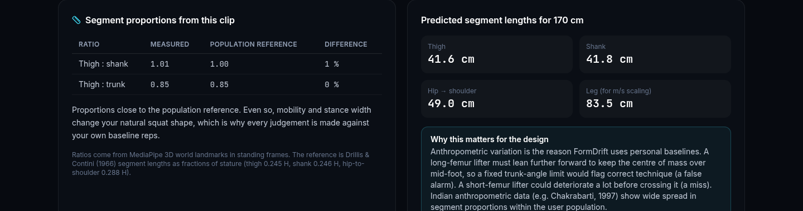

### 3.2 Biomechanics

**Measured operations.** The squat is modelled as a cyclic sagittal-plane movement with frontal-plane deviations. Each metric is computed only in the camera views where 2D video measures it validly. A side camera foreshortens frontal-plane motion and a front camera foreshortens sagittal-plane motion. An oblique camera foreshortens both, so only view-independent metrics are reported for it.

| Metric | Definition | Valid views | Minor / major drift | Rationale |
|---|---|---|---|---|
| **Squat depth** | Peak hip drop ÷ leg length × 100 | all | ≥15 % / ≥30 % loss | Range-of-motion reduction is a classic fatigue compensation; the quadriceps moment peaks near the bottom. |
| **Trunk lean** | Max hip→shoulder inclination from vertical | side | +8° / +15° | Lengthens the upper-body moment arm about L5/S1, raising extensor moment and compression (Chaffin et al., 1999). |
| **Knee tracking (valgus)** | Knee separation ÷ ankle separation at the bottom × 100 | front | ≥10 % / ≥20 % reduction | Normalised knee separation is an established screening measure (Noyes et al., 2005). The 2D frontal-plane projection angle was rejected because it is unstable when the thigh points at the camera in deep flexion. |
| **Lateral hip shift** | Pelvis offset from the centre of the feet ÷ stance width × 100 | front | +8 / +15 points | Asymmetric loading often grows as the weaker side fatigues. |
| **Concentric velocity** | 0.75 × peak depth × leg length (m) ÷ ascent time | all | ≥15 % / ≥30 % loss | Velocity loss is a validated fatigue proxy; around 20 % is a common set-termination cut-off (González-Badillo & Sánchez-Medina, 2010; Pareja-Blanco et al., 2017). |
| **Movement consistency** | 100 × (1 − DTW distance ÷ 0.25) between this rep's hip-height curve and the baseline template, each normalised by its own peak | all | −12 / −25 points | Captures hitches and rhythm changes that peak values miss, without double-counting depth or speed. |

Tempo (descent, bottom pause, ascent) is reported per rep as an informational observation, not scored.

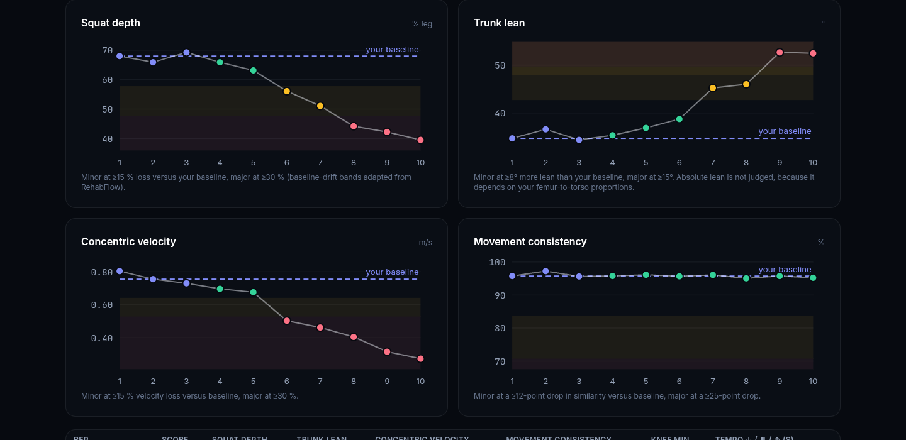

**Rep score.** Each rep starts at 100 and loses up to each metric's weight in proportion to how far its deviation goes towards the major threshold:

\[ \text{score} = 100 - \sum_m w_m \cdot \min\!\left(1.2,\ \frac{\max(0, \text{dev}_m)}{\text{major}_m}\right) \]

The weights are depth 30, knee tracking 30, trunk lean 25, hip shift 20, velocity 15 and consistency 10, so safety and technique outweigh fatigue and consistency. A least-squares trend line with R² over the rep scores summarises the drift (an idea adapted from TechnIQ). **Drift onset** is the first post-baseline rep that, together with the next rep, is flagged on a technique or safety metric; requiring two consecutive reps suppresses one-off noise.

**Lumbar load (static L5/S1 model).** Following the static sagittal approach of Chaffin, Andersson and Martin (1999):

- Upper body: 55 % of body mass, with its centre of mass 40 % up the trunk (de Leva, 1996).
- Load held at the chest: 75 % up the trunk plus 10 cm forward.
- Erector spinae moment arm: 5 cm.

\[ M = m_{ub}\, g\, (0.40\,L_t \sin\theta) + m_{load}\, g\, (0.75\,L_t \sin\theta + 0.10\cos\theta), \qquad F_c = \frac{M}{0.05} + (m_{ub} + m_{load})\, g \cos\theta \]

For the real kettlebell clip (70 kg lifter, 16 kg bell), the estimate ranges from 1.46 to 1.61 kN, peaking on the rep with the most lean. The values are compared with the NIOSH 3.4 kN action limit (Waters et al., 1993). The model is used only to compare reps within a set: it makes the cost of extra lean tangible ("+8 % spinal compression") without claiming clinical accuracy.

**Signal processing.** Frames are sampled at 15 fps by seeking, so results are deterministic and independent of playback. The pipeline then:

- fills gaps of up to 0.6 s by linear interpolation;
- smooths with a zero-phase Gaussian filter;
- segments reps on the depth signal with a 0.35 × peak threshold, merging dips shorter than 0.3 s and rejecting hinges (minimum knee angle above 140°) and incomplete reps;
- times the descent and ascent from 15 % and 90 % depth crossings, interpolated to sub-frame precision.

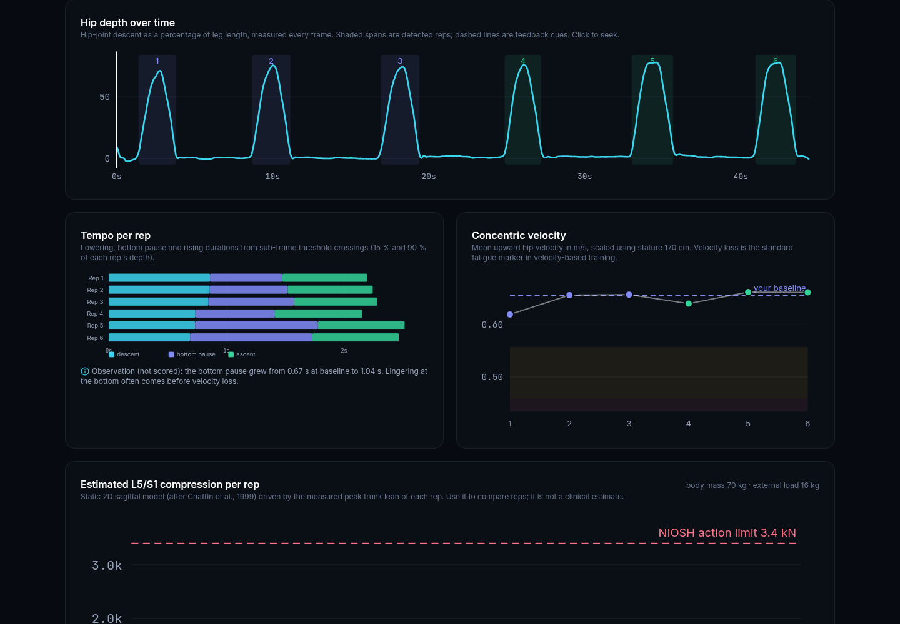

### 3.3 Information handling

The lifter is under physical load, often cannot see the screen, and has little spare attention. Feedback that adds workload can degrade the very movement it is meant to improve. Every cue rule follows from this:

| Rule | Implementation | Basis |
|---|---|---|
| **One cue per rep, at the right moment** | Delivered when the rep ends (standing), never at the bottom | Avoids interrupting the most demanding phase. Terminal feedback suits motor learning (Sigrist et al., 2013). |
| **Few words, external focus** | "Sit deeper", "Chest up", "Knees out", "Even weight", "Consider stopping" | External-focus instructions improve performance and learning (Wulf, 2013). Two words fit working memory under load. |
| **Prioritise** | Safety, then major technique, then minor technique, then fatigue, then consistency | Address the most important problem first. |
| **Throttle** | 3 s cooldown; the same cue at most twice in a row (three times if major) | Prevents nagging and habituation (Sigrist et al., 2013). |
| **Escalate once** | When two or more metrics are major for two reps in a row: "End the set", then silence | Repeating corrections stops helping once technique has broken down. |
| **Choose the channel** | Combined, visual only, audio only, haptic only, or silent | Audio frees the visual channel (Wickens, 2002), haptic suits noisy gyms, and silent defers everything to the summary. |
| **Glanceable visual** | A large ring (purple while calibrating, then green, amber or rose) with a text label; no numbers in the athlete view | Readable from 3 m; colour is never the only code. |
| **Details after the set** | Charts, numbers, explanations and drills appear only in the post-set summary | Separates real-time load from reflective analysis. |

The *Feedback log* shows every candidate cue, including those held back and why ("cooldown", "repeat limit", "stop already recommended"), which makes the information-handling rules inspectable.

In the simulated side-camera set the engine produced: *Baseline set* (rep 3), *Sit deeper* (rep 6), *Chest up* (rep 7), *Sit deeper* (rep 8), *End the set* (rep 9), and suppressed a further cue at rep 10.

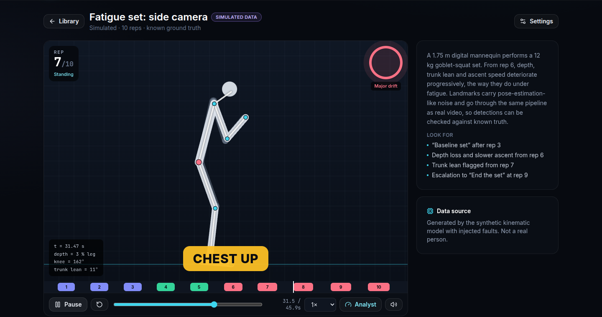

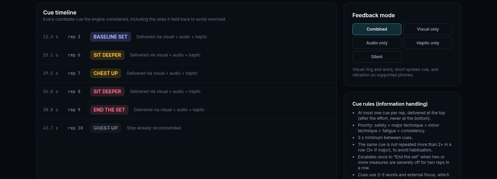

### 3.4 Functional evaluation (summary)

Functional evaluation asks whether the system does what it claims. FormDrift is evaluated on three levels, all reproducible live on the *Validation* page and by `npm run verify` (details in §5):

1. **Known-truth simulation.** Measurement error and drift-flag precision and recall against a kinematic model with injected faults.
2. **Real-video specificity.** Correct rep counts and no false alarms on consistent lifting.
3. **Robustness.** Graceful degradation under landmark noise.

The system also guards its own functional limits:

- Each rep gets a **confidence** score (landmark visibility × detection rate). Reps below 0.45 are marked low-confidence and never flagged.
- **Quality warnings** appear when the person is detected in under 85 % of frames or the feet are out of frame.
- An **oblique-view warning** explains which metrics were not measured.

### 3.5 Aesthetic evaluation

Affective needs (trust, comfort, motivation) are served by the "art" of the interface:

- **Calm and legible.** Dark, high-contrast palette; one accent colour; generous spacing; tabular numerals; three status colours (green, amber, rose) always paired with text labels.
- **Honesty as an aesthetic.** Every result carries a source badge (*Real video · measured*, *Simulated data* or *Your video · measured*). Unmeasurable metrics are listed as "not measurable from this view". The synthetic mannequin is visibly a mannequin. This builds calibrated trust, which matters for a system that tells people their form is wrong.


- **The self-perception check.** Before results appear, the user is asked "When did your form start to slip?". The answer is compared with the measured onset ("You noticed 2 reps later than the measured onset"). It turns the human issue into a personal, memorable insight and is the main affective hook.
- **Respectful framing.** Results explain *what changed, why it matters and what to do* (a corrective drill), rather than only scoring the person.
- **Instruments.** The *Study* page provides the System Usability Scale (Brooke, 1996) and raw NASA-TLX (Hart & Staveland, 1988), stored locally with CSV export.

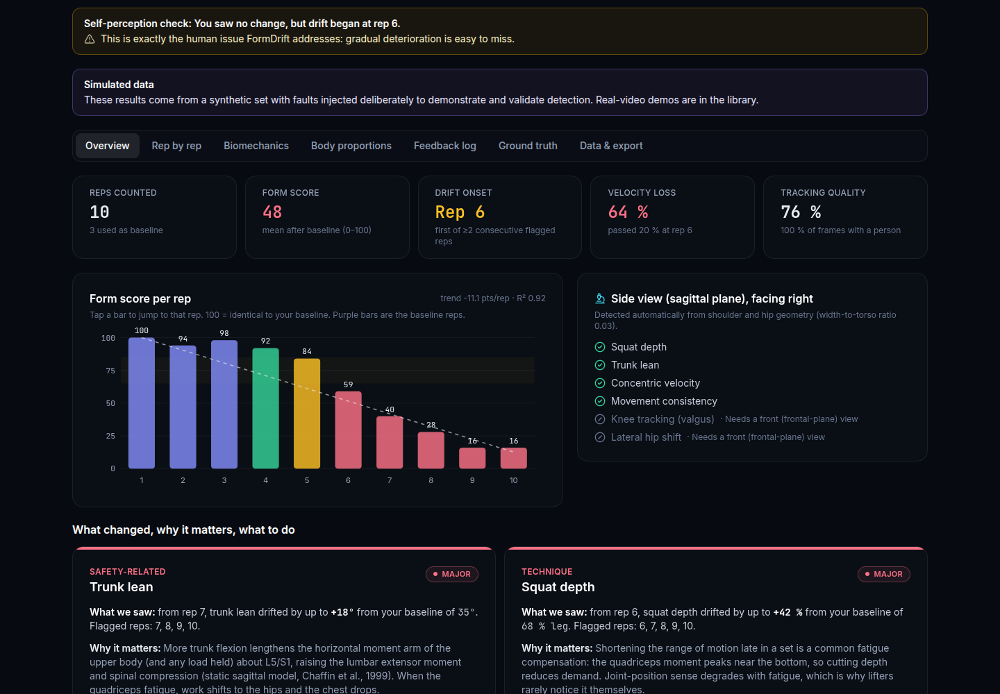

---

## 4. Implementation

### 4.1 Architecture

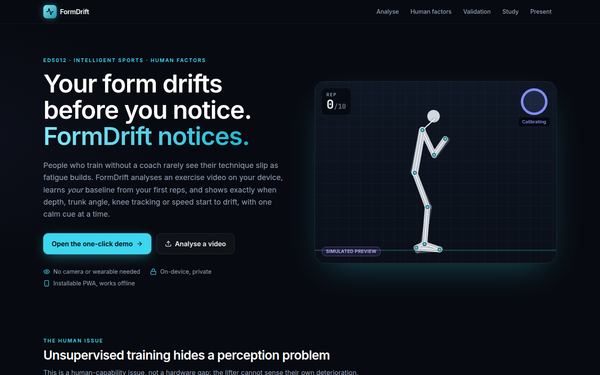

FormDrift is a static Progressive Web App with no backend (see the [README](../README.md#architecture) for the module map):

```
Video ─► MediaPipe Pose Landmarker (WASM/WebGL, 33 image + 33 world landmarks, 15 fps by seeking)
      ─► signal processing (gap fill, zero-phase Gaussian smoothing, leg-length normalisation)
      ─► view classification (shoulder/hip width ÷ torso length: side < 0.28, front ≥ 0.5, else oblique)
      ─► rep segmentation (hysteresis, hinge and incomplete-rep rejection, sub-frame tempo)
      ─► per-rep metrics ─► personal baseline (median of first N reps) ─► deviation and level
      ─► score, trend, drift onset, issues ─► cue engine ─► player HUD and post-set summary
```

| Concern | Choice | Why |
|---|---|---|
| Pose estimation | `@mediapipe/tasks-vision` Pose Landmarker (full), GPU with CPU fallback | Mature, Apache-2.0, runs in the browser, provides 3D world landmarks |
| Front end | Vite, React 19, TypeScript, Tailwind CSS v4 | Fast, typed and maintainable |
| PWA | vite-plugin-pwa (Workbox) | Precaches the app shell, demo clips and cached landmarks; runtime-caches the model and WASM (CacheFirst) |
| Routing | Hash routing with relative base | Works on any static host or subpath (GitHub Pages) |
| Charts | Hand-written SVG | No dependency, crisp at any size, print-friendly |
| Feedback output | Web Speech API, Vibration API, canvas HUD | Built into browsers; no hardware |
| Storage | `localStorage` (profile, study responses) | Private and on-device |
| Layout | Responsive, from a 390 px phone to a 1440 px laptop | The same PWA serves the gym (phone) and the review (laptop) |

### 4.2 Demo mode and honesty

The brief asked for a demo that works reliably on a laptop over Google Meet, with no camera or hardware, and that does not overclaim. FormDrift therefore offers four preloaded sets:

| Set | Source | Purpose |
|---|---|---|
| Fatigue set, side camera | Synthetic kinematic model, 10 reps | Shows depth loss, trunk lean and velocity loss, with ground truth |
| Fatigue set, front camera | Same model, frontal projection | Shows knee valgus and hip shift, with ground truth |
| Kettlebell squat, side view | Real video (CC BY-SA 4.0) | Real MediaPipe measurement; specificity (no false alarms) |
| Barbell back squat, oblique | Real video (CC BY-SA 4.0) | Honest handling of an oblique camera |

The real clips' landmarks were extracted *with the app's own in-browser pipeline* and cached, so the demo opens instantly. A **Re-extract live with MediaPipe** button reruns extraction in the browser to show the cache is genuine; in testing, live re-extraction reproduced the cached results exactly. Users can also upload their own video.

The synthetic model is a 3D stick figure with Drillis & Contini segment lengths (1.75 m). It performs goblet squats with a 1.6 s descent, 0.3 s pause and 1.25 s ascent. A fatigue plan is injected gradually from rep 4 and becomes large from rep 6:

- depth falls to 72 % of the original;
- trunk lean rises by up to 27°;
- ascent slows by up to 62 %;
- knee valgus reaches 5.6 cm;
- hip shift reaches 5.8 cm.

The model is projected to a 640×480 camera with 2.2 px Gaussian noise and reduced far-side visibility, mimicking MediaPipe output. Ground truth comes from the noise-free 3D model.

### 4.3 Reuse of existing work and licensing

The brief asked to reuse properly licensed work and not to copy unlicensed code:

| Source | Licence | Use |
|---|---|---|
| MediaPipe Tasks Vision and the Pose Landmarker model (Google) | Apache-2.0 | Dependency, self-hosted for offline use |
| TechnIQ (younis-y/techniq-form-coach) | MIT | Ideas adapted: per-rep scoring, an R²-gated trend, fault plus drill presentation; rewritten in TypeScript |
| RehabFlow, wwm, FormGuard | No licence | **No code used.** General ideas reimplemented independently: personal baseline and 15/30 % bands, DTW comparison with your own template, Vite + MediaPipe + PWA stack |
| Fitness-AQA (Parmar & Morris, 2022) | Research, non-commercial | Literature support for the fault taxonomy only |
| Demo videos (Taco Fleur; Your Move) via Wikimedia Commons | CC BY-SA 4.0 | Trimmed, cropped and re-encoded, with attribution in the app |

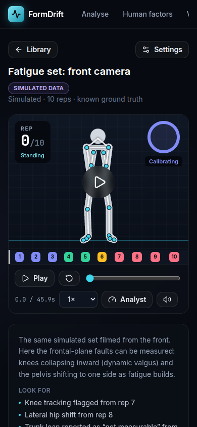

### 4.4 Quality assurance

- `npm run verify`: 14 regression checks covering rep counts, view classification, F1 ≥ 0.95, drift onset and the absence of false alarms on real clips. They run in CI on every push.
- `npm run smoke`: a headless browser walks every page and tab of every demo, as well as the slides and a mobile viewport, and fails on any console error.
- An error boundary keeps a page failure from blanking the app during a demo.

---

## 5. Evaluation

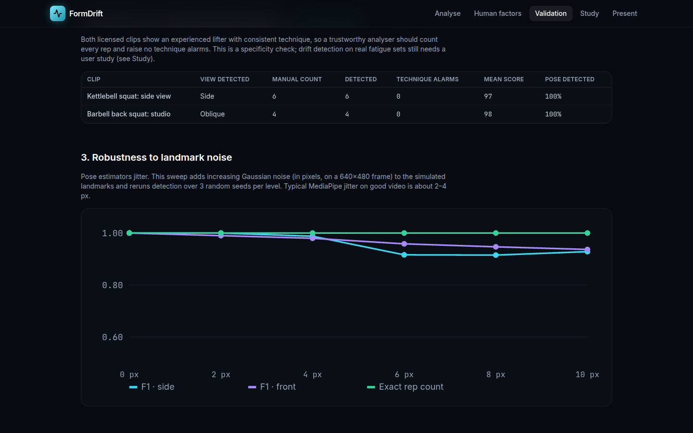

### 5.1 Known-truth simulation

The analysis is run on the simulated sets, and each post-baseline rep's level (ok, minor or major) is compared with the level that the true values deserve under the same baseline rule.

| Camera | Reps | Metric | MAE | TP | FP | FN | TN | Level agreement |
|---|---|---|---|---|---|---|---|---|
| Side | 10/10 | Squat depth | 0.69 % leg | 5 | 0 | 0 | 2 | 100 % |
| | | Trunk lean | 0.77° | 4 | 0 | 0 | 3 | 100 % |
| | | Concentric velocity | 0.027 m/s | 5 | 0 | 0 | 2 | 86 % |
| Front | 10/10 | Squat depth | 0.25 % leg | 5 | 0 | 0 | 2 | 100 % |
| | | Knee tracking | 1.39 % ankle width | 4 | 0 | 0 | 3 | 100 % |
| | | Lateral hip shift | 0.84 % stance | 3 | 0 | 0 | 4 | 100 % |
| | | Concentric velocity | 0.016 m/s | 5 | 0 | 0 | 2 | 100 % |

Overall drift-flag precision is 1.00 and recall 1.00 for both cameras. In both sets, drift onset is detected at rep 6 and velocity loss passes 20 % at rep 6. Mean rep scores fall from about 97–99 in the baseline reps to 48 (side) and 39 (front) after the baseline, with trends of −11 and −13 points per rep (R² = 0.92). The one level disagreement (side-camera velocity, one rep) is a minor-versus-major boundary case, not a missed drift.

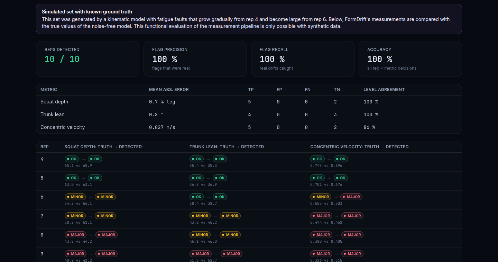

### 5.2 Real video: rep counting and specificity

| Clip | View detected | Manual count | Detected | Technique alarms | Mean score | Pose detected |
|---|---|---|---|---|---|---|
| Kettlebell squat, side (backlit, outdoors) | Side (ratio 0.04) | 6 | 6 | 0 | 97 | 100 % of frames |
| Barbell back squat, studio | Oblique (ratio 0.32) | 4 | 4 | 0 | 98 | 100 % of frames |

Both clips show an experienced lifter with consistent technique, so the correct behaviour is to count every rep and stay silent. FormDrift did so. It still surfaced real, measured variation as information:

- In the kettlebell set, the bottom pause grew from 0.62 s to 1.04 s in reps 5–6 and peak L5/S1 compression rose by about 8 %.
- In the barbell set, velocity fell by 10 % on the last rep, below the threshold.

For the oblique clip, trunk lean and knee valgus were reported as *not measurable* rather than guessed.

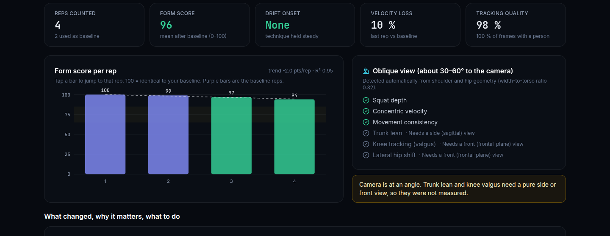

### 5.3 Robustness to landmark noise

Gaussian noise of 0–10 px was added to the simulated landmarks (640×480 frame), with 3 random seeds per level:

| Noise (px) | 0 | 2 | 4 | 6 | 8 | 10 |
|---|---|---|---|---|---|---|
| F1, side | 1.00 | 1.00 | 0.99 | 0.92 | 0.92 | 0.93 |
| F1, front | 1.00 | 0.99 | 0.98 | 0.96 | 0.95 | 0.94 |
| Exact rep count | 100 % | 100 % | 100 % | 100 % | 100 % | 100 % |

Typical MediaPipe jitter on good video is about 2–4 px, where F1 is 0.98 or higher. Degradation is gradual, and precision stays at or above 0.93, so noise causes occasional missed minor flags rather than false alarms. That is the safer failure mode for user trust.

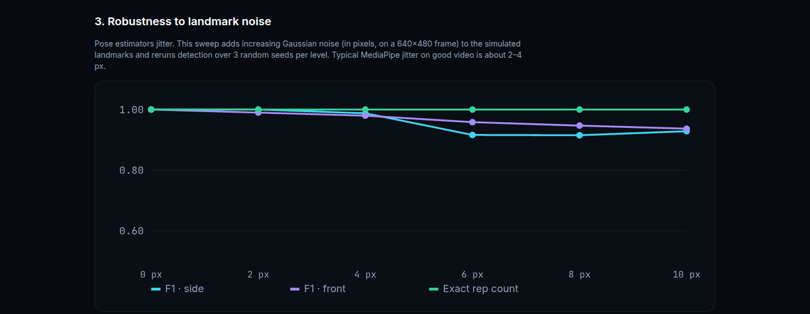

### 5.4 Planned user study (protocol provided in-app)

A formal participant study was outside the course scope, so no participant data is claimed. The *Study* page implements a ready-to-run protocol:

- **Participants:** 8–12 recreational lifters with at least 6 months of training, varied in stature and sex, with informed consent.
- **Design:** within-subjects and counterbalanced, with three conditions: no feedback, audio cues and visual-only cues. Each condition is one 10–12 rep set near failure (goblet or back squat), with the phone side-on at hip height 2–3 m away.
- **Measures:**
  - drift onset, flagged reps, depth and lean deviation, velocity loss;
  - perceived onset from the self-perception check, giving an awareness gap of perceived minus measured onset;
  - SUS, raw NASA-TLX and preferred modality.
- **Hypotheses:**
  - H1: without feedback, perceived onset comes later than measured onset.
  - H2: cued sets contain fewer major-drift reps.
  - H3: SUS ≥ 68, and TLX is lower for audio than for visual cues during effort.
- **Analysis:** Wilcoxon signed-rank tests with effect sizes, appropriate for small n.

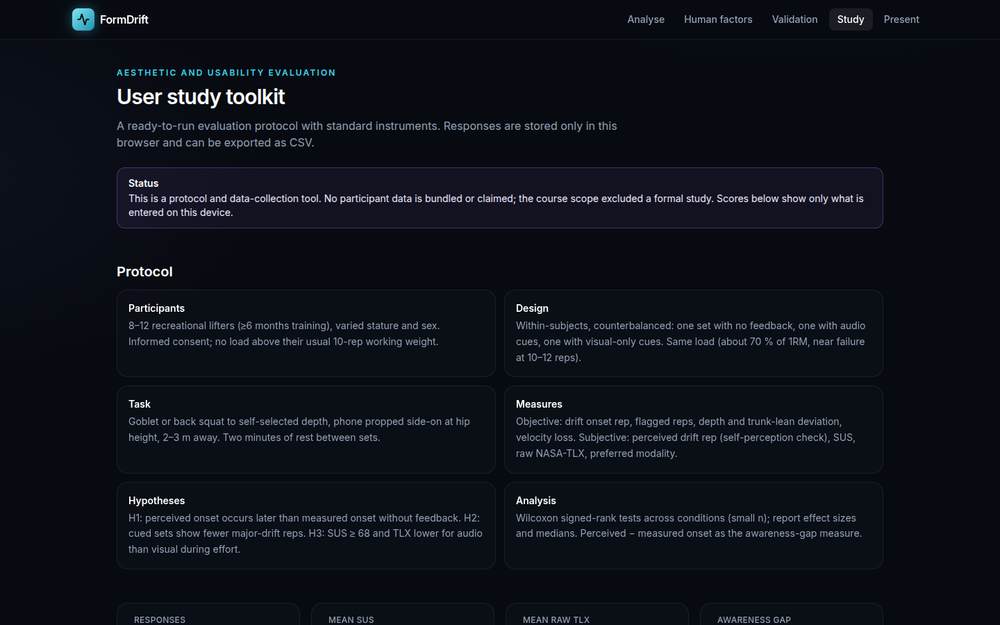

---

## 6. Limitations

1. **A single 2D camera.** Out-of-plane motion is foreshortened. This is mitigated by restricting metrics by view, but a side camera cannot see valgus and a front camera cannot see trunk lean.
2. **Thresholds** come from the literature and the RehabFlow convention (15 %/30 %). They have not been calibrated against expert ratings; Fitness-AQA labels are the obvious next step.
3. **The simulation validates the measurement and decision pipeline**, not the realism of fatigue patterns, which vary between people.
4. **The real demo clips show consistent technique.** They demonstrate specificity, not sensitivity to real fatigue. Real drift detection needs the user study.
5. **Squat only, post-set analysis.** The cue engine is designed for live use, but live camera mode was out of scope for a reliable, hardware-free demo.
6. **The L5/S1 estimate** is a simplified static model for comparing reps, not an absolute or clinical measure.
7. **MediaPipe accuracy** drops with loose clothing, occlusion by equipment, backlighting and low resolution. The app reports tracking quality and per-rep confidence rather than hiding this.
8. **Stature is user-entered.** Velocity in m/s is only as accurate as that input; relative velocity loss is unaffected.

## 7. Future work

- Run the built-in study and report the awareness gap and modality effects.
- Live camera mode using the same cue engine, with latency measured on mid-range phones.
- Extend to the deadlift (hinge segmentation) and lunge; add left/right asymmetry from a front view.
- Calibrate thresholds against coach ratings (Fitness-AQA) and add personalised thresholds based on variability in the baseline reps.
- Optional phone IMU (DeviceMotion) on the bar for velocity, fused with video.

## 8. Conclusion

FormDrift addresses a genuinely human problem: people cannot perceive their own technique drifting under fatigue. It uses a solution designed around human capabilities: a personal baseline (anthropometry), view-aware kinematics and a lumbar load model (biomechanics), one well-timed, few-word cue in a chosen modality (information handling), measured accuracy with honest limits (functional evaluation), and a calm, trustworthy interface with a self-perception check (aesthetic evaluation). It runs entirely in a browser as an installable, offline PWA, so it can be demonstrated live without any hardware.

---

## References

1. Barber-Westin, S. D., Galloway, M., Noyes, F. R., Corbett, G., & Walsh, C. (2005). Assessment of lower limb neuromuscular control in prepubescent athletes. *American Journal of Sports Medicine, 33*(12), 1853–1860.
2. Bazarevsky, V., Grishchenko, I., Raveendran, K., Zhu, T., Zhang, F., & Grundmann, M. (2020). BlazePose: On-device real-time body pose tracking. *CVPR Workshop on Computer Vision for Augmented and Virtual Reality.*
3. Brooke, J. (1996). SUS: A "quick and dirty" usability scale. In P. W. Jordan et al. (Eds.), *Usability Evaluation in Industry* (pp. 189–194). Taylor & Francis.
4. Chaffin, D. B., Andersson, G. B. J., & Martin, B. J. (1999). *Occupational Biomechanics* (3rd ed.). Wiley.
5. Chakrabarti, D. (1997). *Indian Anthropometric Dimensions for Ergonomic Design Practice.* National Institute of Design, Ahmedabad.
6. de Leva, P. (1996). Adjustments to Zatsiorsky–Seluyanov's segment inertia parameters. *Journal of Biomechanics, 29*(9), 1223–1230.
7. González-Badillo, J. J., & Sánchez-Medina, L. (2010). Movement velocity as a measure of loading intensity in resistance training. *International Journal of Sports Medicine, 31*(5), 347–352.
8. Hart, S. G., & Staveland, L. E. (1988). Development of NASA-TLX (Task Load Index): Results of empirical and theoretical research. *Advances in Psychology, 52*, 139–183.
9. Myer, G. D., Kushner, A. M., Brent, J. L., et al. (2014). The back squat: A proposed assessment of functional deficits and technical factors that limit performance. *Strength and Conditioning Journal, 36*(6), 4–27.
10. Noyes, F. R., Barber-Westin, S. D., Fleckenstein, C., Walsh, C., & West, J. (2005). The drop-jump screening test: Difference in lower limb control by gender and effect of neuromuscular training in female athletes. *American Journal of Sports Medicine, 33*(2), 197–207.
11. Panjabi, M. M., & White, A. A. (2000). *Biomechanics in the Musculoskeletal System.* Churchill Livingstone.
12. Pareja-Blanco, F., Rodríguez-Rosell, D., Sánchez-Medina, L., et al. (2017). Effects of velocity loss during resistance training on athletic performance, strength gains and muscle adaptations. *Scandinavian Journal of Medicine & Science in Sports, 27*(7), 724–735.
13. Parmar, P., & Morris, B. (2022). Domain knowledge-informed self-supervised representations for workout form assessment. *European Conference on Computer Vision (ECCV).*
14. Proske, U., & Gandevia, S. C. (2012). The proprioceptive senses: Their roles in signaling body shape, body position and movement, and muscle force. *Physiological Reviews, 92*(4), 1651–1697.
15. Sanders, M. S., & McCormick, E. J. (1993). *Human Factors in Engineering and Design* (7th ed.). McGraw-Hill.
16. Sigrist, R., Rauter, G., Riener, R., & Wolf, P. (2013). Augmented visual, auditory, haptic, and multimodal feedback in motor learning: A review. *Psychonomic Bulletin & Review, 20*(1), 21–53.
17. Waters, T. R., Putz-Anderson, V., Garg, A., & Fine, L. J. (1993). Revised NIOSH equation for the design and evaluation of manual lifting tasks. *Ergonomics, 36*(7), 749–776.
18. Wickens, C. D. (2002). Multiple resources and performance prediction. *Theoretical Issues in Ergonomics Science, 3*(2), 159–177.
19. Winter, D. A. (2009). *Biomechanics and Motor Control of Human Movement* (4th ed.). Wiley.
20. Wulf, G. (2013). Attentional focus and motor learning: A review of 15 years. *International Review of Sport and Exercise Psychology, 6*(1), 77–104.

### Software and media

- MediaPipe Tasks Vision, Google. Apache-2.0. https://github.com/google-ai-edge/mediapipe
- TechnIQ form coach, younis-y. MIT. https://github.com/younis-y/techniq-form-coach
- RehabFlow (Tashbhilare), wwm (pan1624), FormGuard (AmjadShakhshir): credited for ideas only; no code used.
- Fitness-AQA, Parmar & Morris. https://github.com/ParitoshParmar/Fitness-AQA
- "Kettlebell Racked Squats (side view)", Taco Fleur, CC BY-SA 4.0, Wikimedia Commons.
- "Barbell back squat exercise demonstration", Your Move (ymove.app), CC BY-SA 4.0, Wikimedia Commons.
